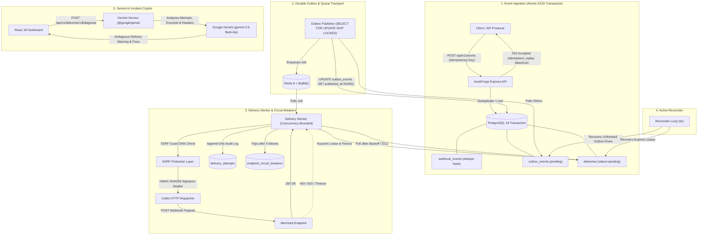

# HookForge ⚡

> **A high-throughput, fault-tolerant webhook delivery and retry engine built as a TypeScript modular monolith with PostgreSQL 18 transactional Outbox, Redis 8 BullMQ queues, lease-fenced workers, Undici HTTP delivery with SSRF protection, circuit breakers, and Google Gemini Incident Copilot.**

[](LICENSE)
[](https://www.typescriptlang.org/)
[](https://nodejs.org/)
[](https://www.postgresql.org/)
[](https://redis.io/)
[](https://ai.google.dev/)
[](https://react.dev/)
[](https://tailwindcss.com/)

---

## Architecture Overview

HookForge is designed around the **Transactional Outbox Pattern** and **Lease-Fenced Background Workers**, guaranteeing bounded at-least-once HTTP webhook delivery without data loss even across power outages, network partitions, or downstream outages.



---

## Delivery Guarantees & Non-Goals

### Guarantees
1. **Bounded At-Least-Once Delivery:** HookForge guarantees that every validly ingested event will be delivered to subscribed active endpoints up to their configured `max_attempts` (default: 5) or moved to the Dead Letter Queue (`dead_letter`). Because network timeouts and TCP socket drops can occur after a receiver executes a payload, **receivers must implement idempotency**. HookForge explicitly does **NOT** make mathematically impossible "exactly-once HTTP delivery" claims.
2. **PostgreSQL 18 as Single Source of Truth:** Redis is used exclusively for volatile queue transport and concurrency rate-limiting. If Redis is completely flushed or restarted, the **Outbox Publisher** and **Reconciler** reconstruct queues from PostgreSQL without lost deliveries.
3. **Lease Fencing:** Each delivery attempt acquires a monotonic `lease_token`. When an attempt finishes, its database update is fenced by `WHERE lease_token = $expected`, eliminating zombie worker race conditions.
4. **Idempotency & Conflict Guard:**
   - Same `Idempotency-Key` + identical payload $\rightarrow$ `202 Accepted` (`idempotent_replay: true`)
   - Same `Idempotency-Key` + differing payload $\rightarrow$ `409 Conflict` (`IDEMPOTENCY_CONFLICT`)
5. **SSRF Guard:** Destination URLs are resolved via `getaddrinfo` and validated before dispatch, blocking IPv4/IPv6 private subnets (`127.0.0.0/8`, `10.0.0.0/8`, `192.168.0.0/16`, `169.254.0.0/16`, AWS IMDS `169.254.169.254`, and carrier-grade NATs).

### Non-Goals
- **No Apache Kafka / Zookeeper:** Unnecessary distributed log complexity; PostgreSQL transactional outbox provides strict atomicity and multi-tenant isolation with zero message loss.
- **No Plaintext Secret Storage:** Webhook signing secrets are encrypted at rest using AES-256-GCM via `HMAC_MASTER_KEY` and only exposed once upon creation or rotation.

---

## Google Gemini Incident Copilot

HookForge integrates **Google Gemini** (`gemini-3.5-flash-lite`) strictly on-demand as a read-only diagnostics engine:
- **Incident Copilot (`POST /api/v1/deliveries/:id/diagnose`):** Synthesizes attempt timelines, HTTP status history, failure classes (`DNS_RESOLUTION_FAILED`, `CONNECTION_REFUSED`, `TIMEOUT`, `UPSTREAM_5XX`), and response excerpts.
- **Ambiguous Delivery Warning Banner:** Flags cases where a TCP timeout occurred after headers were sent, alerting operators that the downstream merchant may have already processed the event and advising idempotency confirmation before replay.
- **Suggested Policy Adjustments:** Proposes bounded timeouts, retry backoff adjustments, and max in-flight settings.
- **Merchant Communication Summary:** Generates a ready-to-copy technical report that support engineers can send to merchant developers.
- **Endpoint Health Report (`POST /api/v1/endpoints/:id/health-report`):** Evaluates overall subscriber stability (`healthy`, `degraded`, `failing`).

---

## Quick-Start with Docker Compose

### Prerequisites
- [Docker](https://docs.docker.com/get-docker/) & [Docker Compose](https://docs.docker.com/compose/)
- [Node.js 22+](https://nodejs.org/) (for local development or CLI tests)

### 1. Clone & Configure Environment
```bash
git clone https://github.com/your-org/hookforge.git
cd hookforge
cp .env.example .env
```
*(Optional)* Add your Google Gemini API key to `.env`:
```ini
GEMINI_API_KEY=your_gemini_api_key_here
GEMINI_MODEL=gemini-3.5-flash-lite
```

### 2. Start the Full Stack
```bash
docker compose up -d --build
```

This launches:
| Service | Container Name | Host Port | Description |
| :--- | :--- | :--- | :--- |
| **PostgreSQL 18** | `hookforge-postgres` | `5433` (or `5432`) | ACID relational persistence & Outbox |
| **Redis 8** | `hookforge-redis` | `6379` | BullMQ delivery queues & rate limiting |
| **Backend API** | `hookforge-api` | `3000` | REST API, auto-migrates & seeds DB |
| **Worker Engine** | `hookforge-worker` | *Internal* | Outbox poller, BullMQ worker, Reconciler |
| **Merchant Simulator** | `hookforge-merchant-simulator` | `4000` | Mock subscriber with failure injection |
| **Frontend Dashboard** | `hookforge-frontend` | `5173` | React 18 + Vite + Tailwind CSS console |

### 3. Open the Dashboard
Navigate to **`http://localhost:5173`** in your browser.
1. Click the Key icon in the top right.
2. Click **"Load Seeded Tenant Key"** to auto-fill `hf_live_demo1234567890abcdef12345678`.
3. The health indicator will display **PG [green]** and **Redis [green]**.

---

## Local Development (Without Docker Compose)

```bash
# 1. Start Postgres & Redis
docker compose up -d postgres redis

# 2. Run Database Migrations & Seed
npm run migrate
npm run seed

# 3. Start Merchant Simulator (Terminal 1)
npm run dev:simulator

# 4. Start Worker Engine (Terminal 2)
npm run dev:worker

# 5. Start Backend REST API (Terminal 3)
npm run dev:backend

# 6. Start Frontend Dashboard (Terminal 4)
npm run dev:frontend
```

---

## Verification & Chaos Testing

### 1. Full Backend Test Suite
Runs all 65 unit and integration tests across Phase 1 through 5:
```bash
npm test
```
```text
✔ Phase 1 Foundation and Infrastructure Tests (9/9)
✔ Phase 2 Core Backend Integration Tests (23/23)
✔ Phase 3 Outbox & BullMQ Worker Tests (5/5)
✔ Phase 4 Reliability Engine & Replay Tests (14/14)
✔ Phase 5 Google Gemini Integration Tests (14/14)
ℹ tests 65 | pass 65 | fail 0
```

### 2. Automated Chaos & Demo Verification Script
Exercises health checks, endpoint registration, HMAC key generation, idempotency deduplication, 409 conflict detection, 503 backoff/DLQ handling, and replay lineage:

**On Windows (PowerShell):**
```powershell
npm run verify:demo
# or: powershell -ExecutionPolicy Bypass -File scripts/demo-verify.ps1
```

**On Linux / macOS (Bash):**
```bash
npm run verify:demo:bash
# or: ./scripts/demo-verify.sh
```

---

## API Reference Summary

All `/api/v1/*` endpoints require `Authorization: Bearer <API_KEY>`.

| Method | Endpoint | Description |
| :--- | :--- | :--- |
| `GET` | `/health/ready` | Public health check (PostgreSQL & Redis connection status) |
| `GET` | `/api/v1/dashboard/metrics` | System telemetry, throughput, success rate, outbox lag, circuit breakers |
| `GET` | `/api/v1/endpoints` | List registered endpoints with circuit breaker states |
| `POST` | `/api/v1/endpoints` | Register endpoint (returns one-time plaintext `signing_secret`) |
| `PATCH` | `/api/v1/endpoints/:id` | Update endpoint status, subscriptions, or retry policy |
| `POST` | `/api/v1/endpoints/:id/rotate-secret` | Rotate HMAC signing secret |
| `POST` | `/api/v1/endpoints/:id/health-report` | Generate Gemini AI endpoint health assessment |
| `POST` | `/api/v1/events` | Ingest event (`Idempotency-Key` header enforced) |
| `GET` | `/api/v1/deliveries` | Query deliveries by status, endpoint, and pagination |
| `GET` | `/api/v1/deliveries/:id` | View full delivery lifecycle and chronological attempt history |
| `POST` | `/api/v1/deliveries/:id/replay` | Manually re-enqueue delivery (requires `reason` for audit log) |
| `POST` | `/api/v1/deliveries/:id/diagnose` | Run Gemini Incident Copilot root cause diagnosis |

---

## Merchant Webhook Signature Verification

Each webhook request sent by HookForge includes standard signature headers:
```http
POST /webhooks HTTP/1.1
Host: merchant.example.com
Content-Type: application/json
X-HookForge-Event-Id: evt_01HW3P...
X-HookForge-Delivery-Id: del_01HW3P...
X-HookForge-Timestamp: 1711234567
X-HookForge-Signature: t=1711234567,v1=5d41402abc4b2a76b9719d911017c592
```

### Verifying Signatures in Node.js / TypeScript:
```typescript
import crypto from 'node:crypto';

function verifyHookForgeSignature(rawBody: Buffer, signatureHeader: string, secret: string): boolean {
  const parts = Object.fromEntries(signatureHeader.split(',').map((p) => p.split('=')));
  const timestamp = parts['t'];
  const signatureHex = parts['v1'];
  if (!timestamp || !signatureHex) return false;

  const message = Buffer.concat([Buffer.from(`${timestamp}.`, 'utf8'), rawBody]);
  const expectedSignature = crypto.createHmac('sha256', secret).update(message).digest('hex');

  return crypto.timingSafeEqual(Buffer.from(expectedSignature, 'hex'), Buffer.from(signatureHex, 'hex'));
}
```

---

## License

This project is licensed under the [MIT License](LICENSE).
