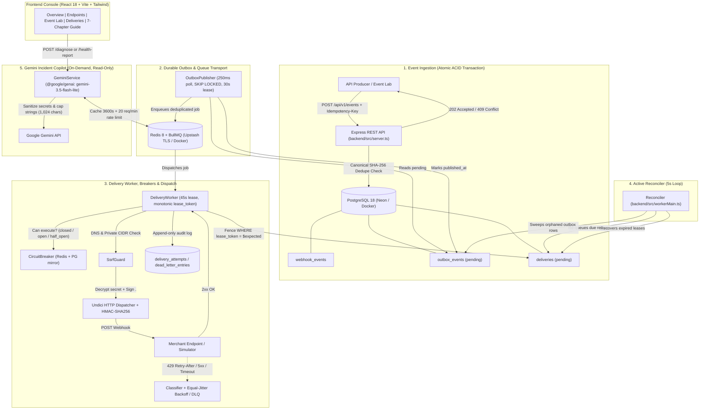

# HookForge ⚡

> **A fault-tolerant webhook delivery, retry, and observability engine built as a TypeScript modular monolith — powered by PostgreSQL 18 Transactional Outbox, Redis 8 + BullMQ queues, lease-fenced workers, Undici HTTP dispatch with SSRF protection, circuit breakers, Google Gemini Incident Copilot, and an interactive React 18 console.**

[](https://www.typescriptlang.org/)
[](https://nodejs.org/)
[](https://www.postgresql.org/)
[](https://redis.io/)
[](https://ai.google.dev/)
[](https://react.dev/)
[](https://tailwindcss.com/)

---

## 1. Vertical, Persona & Problem Statement Alignment

- **Chosen Vertical:** B2B Developer Infrastructure & SaaS Event Integration (Payments, E-Commerce, and Multi-Tenant Webhook Delivery).
- **Target Persona:** Platform backend engineers emitting mission-critical lifecycle events (`order.created`, `payment.completed`, `invoice.payment_failed`), subscriber developers verifying webhooks safely, and on-call operators diagnosing merchant integration incidents.
- **The Real-World Problem:**
  1. **Polling wastes resources and lags:** Asking downstream APIs *"Did anything change?"* every few seconds burns CPU, database connections, and rate limits.
  2. **Fire-and-forget HTTP drops events:** Inline `fetch()` calls lose webhook events permanently whenever a merchant server restarts, hits a `503 Service Unavailable`, or drops a TCP socket.
  3. **Naive retries cause cascading outages:** Retrying immediately at fixed intervals slams recovering merchant servers ("thundering herd") without honoring `Retry-After` headers or circuit breaking.
  4. **Opaque failure telemetry:** When deliveries fail in production, operators lack attempt-by-attempt history, safe replay lineage, and actionable merchant-ready root-cause explanations.

**How HookForge Solves It:** HookForge persists every event and delivery obligation atomically inside PostgreSQL 18 before queuing, dispatches via lease-fenced BullMQ workers with full security hardening (AES-256-GCM + HMAC-SHA256 + SSRF defense), shields struggling receivers via jittered backoff and Redis circuit breakers, preserves dead letters for non-destructive replay, and provides on-demand AI incident diagnosis via Google Gemini.

---

## 2. Architecture & Modular Monolith Design

HookForge is structured as a clean **TypeScript modular monolith** with separate API and background-worker processes sharing a core engine:



### Repository Structure
| Path | Purpose |
| :--- | :--- |
| [backend/src/server.ts](file:///c:/Users/Mittal%20Halarnekar/Desktop/AI-vibeathon/backend/src/server.ts) & [backend/src/app.ts](file:///c:/Users/Mittal%20Halarnekar/Desktop/AI-vibeathon/backend/src/app.ts) | Express HTTP server, CORS allowlisting (`https://ai-vibeathon.vercel.app`, `CORS_ORIGIN`, `FRONTEND_URL`, localhost), request IDs, JSON bounds (`1mb`), centralized error handling. |
| [backend/src/workerMain.ts](file:///c:/Users/Mittal%20Halarnekar/Desktop/AI-vibeathon/backend/src/workerMain.ts) | Standalone background worker entrypoint running `OutboxPublisher` (`250ms`), `DeliveryWorker`, and `Reconciler` (`5000ms`) with graceful shutdown. |
| [backend/src/config/env.ts](file:///c:/Users/Mittal%20Halarnekar/Desktop/AI-vibeathon/backend/src/config/env.ts) | Joi-validated environment configuration (`DATABASE_URL`, `DATABASE_CONNECTION_TIMEOUT_MS`, `REDIS_URL`, `HMAC_MASTER_KEY`, `GEMINI_MODEL`, SSRF & CORS vars). |
| [backend/src/database/](file:///c:/Users/Mittal%20Halarnekar/Desktop/AI-vibeathon/backend/src/database/pool.ts) | Resilient PostgreSQL pool (`buildPgPoolConfig`, Neon cold-start retry & TLS/channel binding, `withTransaction`), idempotent SQL migration runner (`001`–`004`), demo seed script, and `rediss://` TLS Redis/BullMQ factory. |
| [backend/src/modules/](file:///c:/Users/Mittal%20Halarnekar/Desktop/AI-vibeathon/backend/src/modules/events/events.service.ts) | Clean controller/service/repository/schema modules for `endpoints`, `events`, `deliveries`, `dashboard`, `gemini`, and `health`. |
| [backend/src/engine/](file:///c:/Users/Mittal%20Halarnekar/Desktop/AI-vibeathon/backend/src/engine/workers/deliveryWorker.ts) | Core reliability engine (`outboxPublisher.ts`, `deliveryWorker.ts`, `reconciler.ts`, `circuitBreaker.ts`, `hmacSigner.ts`, `ssrfGuard.ts`, `httpDispatcher.ts`, `classifier.ts`, `retryPolicy.ts`). |
| [frontend/src/](file:///c:/Users/Mittal%20Halarnekar/Desktop/AI-vibeathon/frontend/src/App.tsx) | React 18 + TypeScript + Tailwind CSS dashboard (`OverviewPage`, `EndpointsPage`, `EventLabPage`, `DeliveriesPage`, `GuidePage`, `DeliveryDetailModal`, `ConfirmModal`, `Header`). |
| [merchant-simulator/](file:///c:/Users/Mittal%20Halarnekar/Desktop/AI-vibeathon/merchant-simulator/src/app.ts) | Mock webhook target server supporting `/scenario/success`, `/bad-request`, `/rate-limit`, `/server-error`, `/slow`, `/reset`, and `/duplicate-check` with live HMAC verification. |
| [scripts/](file:///c:/Users/Mittal%20Halarnekar/Desktop/AI-vibeathon/scripts/demo-verify.ps1) | End-to-end automated chaos & reliability verification suites (`demo-verify.ps1` and `demo-verify.sh`). |

---

## 3. How the Solution Works (End-to-End Flow & Gemini Copilot)

### Step 1: Endpoint Registration, AES-256-GCM Encryption & SSRF Protection
- Calling `POST /api/v1/endpoints` validates the target URL with `SsrfGuard` (blocking loopback `127.0.0.0/8`, RFC 1918 private subnets, cloud IMDS `169.254.169.254`, private IPv6 ranges, embedded URL credentials, and URL fragments, while allowing local simulator targets when `ALLOW_INSECURE_HTTP_ENDPOINTS=true` and host is in `ALLOWED_INTERNAL_HOSTS`).
- HookForge generates a 256-bit `whsec_...` signing secret, encrypts it at rest using **AES-256-GCM** (`v1:<iv>:<auth_tag>:<ciphertext>` keyed via `HMAC_MASTER_KEY`), and reveals the plaintext secret **once** on creation/rotation.

### Step 2: Event Ingestion & Canonical Idempotency
- Calling `POST /api/v1/events` requires an `Idempotency-Key` header and computes a deterministic SHA-256 hash over the canonicalized JSON body (`canonicalizeJson` in `backend/src/shared/crypto.ts`).
- **New event:** Atomically inserts `webhook_events`, per-endpoint `deliveries`, and `outbox_events` in one PostgreSQL transaction and returns **`202 Accepted`** (`idempotent_replay: false`).
- **Exact duplicate:** Same `Idempotency-Key` + identical payload returns **`202 Accepted`** (`idempotent_replay: true`) without creating extra deliveries.
- **Conflicting mutation:** Same `Idempotency-Key` + different payload returns **`409 Conflict`** (`IDEMPOTENCY_CONFLICT`) to preserve ledger integrity.

### Step 3: Signed Dispatch, Backoff, Circuit Breakers & Replay Lineage
- `DeliveryWorker` computes `HMAC-SHA256` over `<timestamp>.<raw_utf8_bytes>` and attaches:
  - `X-HookForge-Event-Id`, `X-HookForge-Delivery-Id`, `X-HookForge-Timestamp`, `X-HookForge-Key-Id`, `X-HookForge-Signature: t=<ts>,v1=<hex>`.
- Retryable failures (`5xx`, `429`, `408`, network timeouts/resets) apply **exponential backoff with equal jitter** (`initial 1000ms`, `2x` multiplier, capped at `300000ms`, max age `7d`) and honor RFC 9110 `Retry-After` headers.
- After **5 consecutive failures**, the per-endpoint `CircuitBreaker` trips to `open` (`30s` cooldown), deferring outbound calls until `half_open` probe recovery succeeds.
- Exhausted or terminal `4xx` deliveries escalate to `dead_letter_entries`. Operators can inspect every attempt and trigger `POST /api/v1/deliveries/:id/replay` with a mandatory audit `reason`, creating a linked `Replay #N` delivery (`replay_of_delivery_id`) while preserving original failure history.

### Step 4: On-Demand Google Gemini Incident Copilot
- **`POST /api/v1/deliveries/:id/diagnose`** & **`POST /api/v1/endpoints/:id/health-report`** run strictly on-demand via `@google/genai` using **`gemini-3.5-flash-lite`** (configurable via `GEMINI_MODEL`).
- **Read-Only & Sanitized:** `sanitizeTelemetryForAI` strips sensitive headers (`authorization`, `x-hookforge-signature`, `cookie`, `x-api-key`, etc.) and redacts credential-like fields (`secret`, `password`, `token`, `key_hash`, etc.), truncating strings above `1,024` characters.
- **Ambiguous Delivery Warning:** Flags timeouts occurring after request dispatch, reminding operators to verify merchant idempotency before replaying.
- **Quota & Cost Protection:** Results are cached in Redis for `3,600s` (`force_refresh` defaults to `false`), protected by a `20 req/min` per-organization limit, use a `20s` per-attempt timeout with transient `503`/`UNAVAILABLE` backoff (`1000ms`, `2500ms`), and **explicitly never retry `429` / `RESOURCE_EXHAUSTED`** errors so daily free-tier quotas are preserved.

### Step 5: 5-Tab Console & Beginner-Friendly 7-Chapter Guide
The React dashboard exposes 5 tabs: **Overview**, **Endpoints**, **Event Lab**, **Deliveries**, and **Guide**. The **Guide** ([frontend/src/pages/GuidePage.tsx](file:///c:/Users/Mittal%20Halarnekar/Desktop/AI-vibeathon/frontend/src/pages/GuidePage.tsx)) features 7 progressive chapters written at an **8th-grade readability level**, each starting with an *"In Simple Words"* summary card, everyday analogies, copyable code snippets, diagrams, and direct navigation buttons into live tabs.

---

## 4. Assumptions & Honest Guarantees

1. **Bounded At-Least-Once Delivery (Not "Exactly-Once" HTTP):** True exactly-once delivery across physical networks is mathematically impossible—a receiver can process an event and lose TCP connectivity before its `200 OK` response reaches HookForge. HookForge guarantees **bounded at-least-once delivery** (up to configured `max_attempts`, default `5`) and relies on subscribers verifying `X-HookForge-Signature` and deduplicating by `X-HookForge-Event-Id` / business order IDs.
2. **PostgreSQL 18 as Single Source of Truth:** Redis 8 is used exclusively for volatile BullMQ job transport, circuit-breaker fast-path state, AI caching, and rate-limit counters. If Redis restarts or is flushed, `OutboxPublisher` and `Reconciler` reconstruct delivery work from PostgreSQL without losing events.
3. **Multi-Tenant Isolation:** All `/api/v1/*` routes authenticate via `Bearer <API_KEY>` SHA-256 hash lookup (`api_keys`) and scope every SQL query and Redis rate/breaker key by `organization_id`, returning `404 NOT_FOUND` on cross-tenant resource lookups.
4. **Cloud Cold-Start Tolerance:** Serverless Postgres (Neon scale-to-zero) and free-tier PaaS services (Render) can exhibit cold starts of `10–30s`. Both `backend/src/database/pool.ts` (`30s` `connectionTimeoutMillis` + transient connect retries) and `frontend/src/api/client.ts` (`35s–45s` `AbortController` timeouts + clear retry messaging) are tuned for these characteristics.

---

## 5. Alignment with Evaluation Criteria

| Criterion | How HookForge Addresses It |
| :--- | :--- |
| **Code Quality** | Modular TypeScript architecture (`controller → service → repository` + decoupled `engine/`), strict Joi payload/env validation (`allowUnknown: false`), centralized typed error hierarchy ([errors.ts](file:///c:/Users/Mittal%20Halarnekar/Desktop/AI-vibeathon/backend/src/shared/errors.ts)), and zero SQL/code duplication. |
| **Security** | AES-256-GCM encrypted endpoint secrets, timing-safe HMAC-SHA256 webhook signatures, DNS-resolving SSRF protection blocking private/IMDS IPs, strict multi-tenant scoping, origin-allowlisted CORS, AI payload secret redaction, and `.gitignore`-excluded `.env` credentials. |
| **Efficiency** | Atomic outbox batching via `SELECT ... FOR UPDATE SKIP LOCKED`, Undici persistent HTTP client, Redis caching (`3600s`) + `20 req/min` rate limiting for Gemini, `429` non-retry protection, equal-jitter backoff, and per-endpoint circuit breakers. |
| **Testing & Verification** | Automated build & integration suite across **73 backend tests** spanning Phases 1–5 (**71 passed, 0 failed, 2 live-Gemini tests gated behind `RUN_LIVE_GEMINI_TESTS=true`**), clean frontend TypeScript + Vite production builds, and 7-check live reliability verification (`scripts/demo-verify.ps1` & `.sh`). |
| **Accessibility & Usability** | High-contrast dark UI, responsive desktop/tablet/mobile layouts, loading/empty/degraded/cold-start error banners, one-click seeded tenant demo setup, and an 8th-grade-readable 7-chapter interactive **Guide**. |

---

## 6. Local Setup, Cloud Deployment & Verification

### A. Quick Start with Docker Compose
```bash
cp .env.example .env
docker compose up -d --build
```
Services exposed:
- **Frontend Console:** `http://localhost:5173`
- **Backend API:** `http://localhost:3000` (`GET /health/ready`)
- **Merchant Simulator:** `http://localhost:4000`
- **PostgreSQL 18:** `localhost:5433` (or `5432`) | **Redis 8:** `localhost:6379`

### B. Local Node + Docker DB Development Workflow
```bash
# 1. Start PostgreSQL 18 & Redis 8
docker compose up -d postgres redis

# 2. Apply SQL migrations and seed demo tenant (hf_live_demo1234567890abcdef12345678)
npm --prefix backend run migrate
npm --prefix backend run seed

# 3. Launch services in separate terminals
npm --prefix merchant-simulator run dev   # http://localhost:4000
npm --prefix backend run worker           # OutboxPublisher, DeliveryWorker, Reconciler
npm --prefix backend run dev              # http://localhost:3000
npm --prefix frontend run dev             # http://localhost:5173
```

### C. Production Deployment Notes (Vercel + Render + Neon + Upstash)
- **Live Frontend (Vercel):** `https://ai-vibeathon.vercel.app/`
  - Set `VITE_API_BASE_URL=https://ai-vibeathon.onrender.com/api/v1` in Vercel Project Environment Variables and trigger a redeploy.
- **Live Backend API & Worker (Render):** `https://ai-vibeathon.onrender.com`
  - Configure both the **Web Service** (`npm --prefix backend run start`) and **Background Worker** (`node backend/dist/workerMain.js`) with:
    - `DATABASE_URL`: Neon PostgreSQL URI (`?sslmode=verify-full&channel_binding=require` or `?sslmode=require&channel_binding=require`)
    - `DATABASE_CONNECTION_TIMEOUT_MS`: `30000`
    - `REDIS_URL`: Upstash TLS Redis URI (`rediss://default:<token>@<host>:6379`)
    - `HMAC_MASTER_KEY`: identical ≥32-char secret on both API and Worker
    - `CORS_ORIGIN` / `FRONTEND_URL`: `https://ai-vibeathon.vercel.app`
    - `GEMINI_API_KEY` & `GEMINI_MODEL=gemini-3.5-flash-lite`

### D. Builds, Automated Tests & Live Demo Verification
```powershell
# TypeScript builds
npm --prefix backend run build
npm --prefix frontend run build

# Full backend integration & unit test suite (Phases 1-5)
npm --prefix backend test

# Optional: run live upstream Gemini tests (requires valid GEMINI_API_KEY)
# $env:RUN_LIVE_GEMINI_TESTS="true"; npm --prefix backend run test:phase5

# Automated end-to-end 7-check demo & chaos verification (requires API + Worker + Simulator running)
npm run verify:demo          # Windows PowerShell (scripts/demo-verify.ps1)
# npm run verify:demo:bash   # Linux/macOS (scripts/demo-verify.sh)
```

---

## API Reference Summary

All `/api/v1/*` routes require `Authorization: Bearer <API_KEY>` (seeded demo key: `hf_live_demo1234567890abcdef12345678`).

| Method | Endpoint | Description |
| :--- | :--- | :--- |
| `GET` | `/health/live` | Process liveness probe |
| `GET` | `/health/ready` | Public PostgreSQL & Redis readiness check (`200` ready / `503` degraded) |
| `GET` | `/api/v1/dashboard/metrics` | Delivery totals, success rate, avg latency, outbox lag, circuit breakers |
| `GET` / `POST` | `/api/v1/endpoints` | List endpoints or register new endpoint (one-time plaintext `signing_secret`) |
| `PATCH` | `/api/v1/endpoints/:id` | Update URL, status, subscriptions, rate limit, or retry policy |
| `POST` | `/api/v1/endpoints/:id/rotate-secret` | Rotate AES-256-GCM encrypted HMAC signing secret |
| `POST` | `/api/v1/endpoints/:id/health-report` | Generate Gemini AI endpoint stability report |
| `POST` / `GET` | `/api/v1/events` | Ingest event (`Idempotency-Key` enforced) or list organization events |
| `GET` | `/api/v1/deliveries` | List deliveries filtered by `status` or `endpoint_id` |
| `GET` | `/api/v1/deliveries/:id` | View full delivery lifecycle, attempt timeline, and DLQ status |
| `POST` | `/api/v1/deliveries/:id/replay` | Re-enqueue delivery with audit `reason` (`Replay #N` lineage) |
| `POST` | `/api/v1/deliveries/:id/diagnose` | Run Gemini Incident Copilot root-cause diagnosis (`429`-safe) |

---

## License

This project is licensed under the MIT License.
