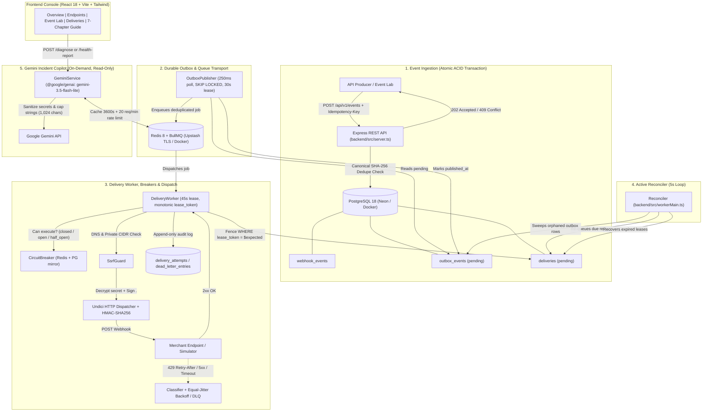

# HookForge ⚡

> **A fault-tolerant webhook delivery, retry, and observability engine built as a TypeScript modular monolith — powered by PostgreSQL 18 Transactional Outbox, Redis 8 + BullMQ queues, lease-fenced workers, Undici HTTP dispatch with SSRF protection, circuit breakers, Google Gemini Incident Copilot, and an accessible React 18 console.**

[](https://www.typescriptlang.org/)
[](https://nodejs.org/)
[](https://www.postgresql.org/)
[](https://redis.io/)
[](https://ai.google.dev/)
[](https://react.dev/)
[](https://tailwindcss.com/)

---

## 1. Chosen Vertical, Persona & Problem Statement Alignment

- **Chosen Vertical:** B2B Developer Infrastructure & SaaS Event Integration (Payments, E-Commerce, and Multi-Tenant Webhook Delivery).
- **Target Persona:**
  - **Platform Backend Engineers** emitting mission-critical lifecycle events (`order.created`, `payment.captured`, `payment.failed`, `invoice.paid`).
  - **Subscriber Developers** verifying signed payloads safely without opening endpoints to spoofed traffic.
  - **On-Call Operations Engineers** diagnosing merchant receiver outages, inspecting attempt timelines, and triggering audited replays.
- **The Real-World Problem:**
  1. **Continuous polling wastes compute & rate limits:** Asking downstream APIs *"Did anything change?"* on tight intervals consumes CPU, DB pools, and API quotas even when zero events occur.
  2. **Fire-and-forget HTTP permanently drops events:** Calling `fetch()` inside a checkout request loses webhook notifications whenever a merchant server restarts, returns `503 Service Unavailable`, or hits a network timeout.
  3. **Naive fixed-interval retries worsen outages:** Immediate un-jittered retries create "thundering herd" traffic spikes that prevent overloaded subscriber APIs from recovering.
  4. **Blind failure troubleshooting:** Without per-attempt forensic history, dead-letter isolation, replay lineage, and human-readable AI incident synthesis, operators waste hours correlating logs across services.

**How HookForge Solves It:** HookForge persists every webhook event, delivery obligation, and outbox record inside a single PostgreSQL 18 ACID transaction before queuing; dispatches asynchronously via lease-fenced BullMQ workers with full security hardening (AES-256-GCM secrets + HMAC-SHA256 signing + SSRF blocking); adapts dynamically to receiver behavior via equal-jitter backoff and circuit breakers; preserves failed deliveries in a dead-letter queue (`dead_letter_entries`) with audited non-destructive replay; and offers an on-demand Google Gemini Incident Copilot to explain failures safely.

---

## 2. Dynamic Engine & Context-Aware Decision Making

HookForge combines **deterministic adaptive runtime policy** with an **on-demand, context-aware Google Gemini assistant** so every delivery and operator action reflects live endpoint telemetry:

### Adaptive Runtime Decision Making (Core Engine)
1. **Payload-Aware Idempotency Gate (`POST /api/v1/events`):**
   - Computes a canonical SHA-256 hash (`canonicalizeJson` in `backend/src/shared/crypto.ts`) paired with the required `Idempotency-Key` header.
   - **New event:** Atomically commits `webhook_events`, subscribed `deliveries`, and `outbox_events`, returning **`202 Accepted`** (`idempotent_replay: false`).
   - **Exact duplicate:** Returns **`202 Accepted`** (`idempotent_replay: true`) without creating redundant outbound work.
   - **Conflicting mutation:** Rejects mismatched payloads reusing the same key with **`409 Conflict`** (`IDEMPOTENCY_CONFLICT`).
2. **Dynamic Retry & Backoff Classification (`classifier.ts` + `retryPolicy.ts`):**
   - Classifies `2xx` as `succeeded`, permanent `4xx` responses (except `408` & `429`) as immediate non-retryable dead letters, and `5xx` / `429` / `408` / TCP resets / timeouts as retryable failures.
   - Applies exponential backoff with **equal jitter** (`initial 1000ms`, `2x` multiplier, `300000ms` cap, `7d` max age) while explicitly honoring upstream RFC 9110 `Retry-After` headers.
3. **Per-Endpoint Circuit Breakers (`closed` → `open` → `half_open`) & Concurrency/Rate Controls:**
   - Enforces per-endpoint `max_in_flight` leases, Redis token/window `rate_limit_per_minute`, and a **5-failure consecutive threshold** (`circuitBreaker.ts`) that opens the breaker for `30s` and tests recovery via `half_open` probes.
   - Worker updates carry monotonic `lease_token` fencing (`WHERE lease_token = $expected`), while `OutboxPublisher` (`250ms`) and `Reconciler` (`5000ms`) automatically recover stalled leases and orphaned outbox jobs.

### Read-Only Google Gemini Incident Copilot (`gemini.service.ts`)
- **Two Dedicated Diagnostics Endpoints:**
  - `POST /api/v1/deliveries/:id/diagnose` — synthesizes delivery status, attempt history, HTTP status codes, failure classes, response snippets, and ambiguous-timeout signals into structured JSON (`summary`, `probable_root_cause`, `retry_recommendation`, `ambiguity_warning`, `merchant_action_items`).
  - `POST /api/v1/endpoints/:id/health-report` — aggregates endpoint metrics, failure class breakdown, and circuit breaker state into health verdicts (`healthy`, `degraded`, `critical`) and suggested policy tuning (`max_attempts`, `attempt_timeout_ms`, `max_in_flight`).
- **Strictly Context-Sanitized & Quota-Protected:**
  - `sanitizeTelemetryForAI` strips sensitive headers (`authorization`, `x-hookforge-signature`, `cookie`, `x-api-key`) and redacts secret/token keys while capping long strings at `1,024` characters.
  - Powered by `@google/genai` (`gemini-3.5-flash-lite` default), cached in Redis for `3,600s` (`force_refresh` defaults to `false`), protected by a `20 req/min` per-org rate limit, `20s` attempt timeouts with `1000ms`/`2500ms` backoff on transient `503`/`UNAVAILABLE`, and **explicitly skips retries on `429` / `RESOURCE_EXHAUSTED`** so free-tier quotas are never burned.

---

## 3. Architecture & End-to-End Flow



### Repository Structure
| Path | Purpose |
| :--- | :--- |
| [backend/src/server.ts](backend/src/server.ts) & [backend/src/app.ts](backend/src/app.ts) | Express HTTP server, allowlisted CORS (`https://ai-vibeathon.vercel.app`, `CORS_ORIGIN`, `FRONTEND_URL`, localhost), request IDs, JSON bounds (`1mb`), centralized error handling. |
| [backend/src/workerMain.ts](backend/src/workerMain.ts) | Standalone worker process running `OutboxPublisher` (`250ms`), `DeliveryWorker`, and `Reconciler` (`5000ms`) with graceful shutdown. |
| [backend/src/config/env.ts](backend/src/config/env.ts) | Joi-validated configuration (`DATABASE_URL`, `DATABASE_CONNECTION_TIMEOUT_MS`, `REDIS_URL`, `HMAC_MASTER_KEY`, `GEMINI_MODEL`, SSRF & CORS vars). |
| [backend/src/database/](backend/src/database/pool.ts) | PostgreSQL pool (`buildPgPoolConfig`, Neon cold-start retry & TLS, `withTransaction`), SQL migrations (`001`–`004`), seed script, and `rediss://` TLS Redis/BullMQ factory. |
| [backend/src/modules/](backend/src/modules/events/events.service.ts) | Modular `controller → service → repository` slices for `endpoints`, `events`, `deliveries`, `dashboard`, `gemini`, and `health`. |
| [backend/src/engine/](backend/src/engine/workers/deliveryWorker.ts) | Core engine (`outboxPublisher.ts`, `deliveryWorker.ts`, `reconciler.ts`, `circuitBreaker.ts`, `hmacSigner.ts`, `ssrfGuard.ts`, `httpDispatcher.ts`, `classifier.ts`, `retryPolicy.ts`). |
| [frontend/src/](frontend/src/App.tsx) | React 18 + TypeScript + Tailwind console (`OverviewPage`, `EndpointsPage`, `EventLabPage`, `DeliveriesPage`, `GuidePage`, `DeliveryDetailModal`, `ConfirmModal`, `Header`). |
| [merchant-simulator/](merchant-simulator/src/app.ts) | Interactive receiver simulator (`/scenario/success`, `/bad-request`, `/retryable`, `/server-error`, `/slow`, `/reset`, `/duplicate-check`) with live HMAC verification. |
| [scripts/](scripts/demo-verify.ps1) | End-to-end automated reliability & chaos verification scripts (`demo-verify.ps1` and `demo-verify.sh`). |

---

## 4. Assumptions & Honest Guarantees

1. **Bounded At-Least-Once Delivery (Not Impossible "Exactly-Once" HTTP):** True exactly-once delivery over unreliable TCP/IP networks is impossible—a merchant can commit an order and drop the socket before `200 OK` arrives. HookForge guarantees **bounded at-least-once delivery** (up to `max_attempts`, default `5`) and pairs every dispatch with `X-HookForge-Signature` (`HMAC-SHA256` over `<ts>.<raw_utf8_bytes>`) and `X-HookForge-Event-Id` so subscribers can verify authenticity and deduplicate safely.
2. **PostgreSQL 18 as Single Source of Truth:** Redis 8 powers ephemeral BullMQ queues, circuit-breaker fast paths, AI response caching, and rate limits. Even if Redis restarts or is cleared, `OutboxPublisher` and `Reconciler` reconstruct pending delivery work from PostgreSQL.
3. **Strict SSRF & Multi-Tenant Isolation:** `SsrfGuard` resolves hostnames and blocks loopback (`127.0.0.0/8`), RFC 1918 subnets, cloud metadata (`169.254.169.254`), private IPv6 CIDRs, embedded credentials, and URL fragments (with explicit opt-in `ALLOW_INSECURE_HTTP_ENDPOINTS` + `ALLOWED_INTERNAL_HOSTS` for local simulator testing). Every `/api/v1/*` route authenticates via SHA-256 `api_keys` lookup and scopes queries by `organization_id` (`404 NOT_FOUND` on cross-tenant access).
4. **Cloud Cold-Start Resilience:** Serverless PostgreSQL cold starts (Neon) and free-tier PaaS wakeups (Render) are tolerated via `DATABASE_CONNECTION_TIMEOUT_MS=30000` + pool connect retries (`backend/src/database/pool.ts`) and explicit `AbortController` timeouts (`frontend/src/api/client.ts`).

---

## 5. Accessibility & Inclusive Console Design

The React 18 UI (`frontend/src/`) is designed for keyboard, screen-reader, and beginner usability while preserving a crisp, high-contrast dark theme:
- **Semantic Landmarks & Live Regions:** Uses `<header>`, `<nav>`, `<main id="main-content">`, `<section>`, `<aside>`, `role="status"` on API readiness pills, and `aria-live="polite"` toast notifications (`ToastContext.tsx`).
- **Skip Navigation & Visible Focus Rings:** Includes a keyboard-accessible **"Skip to main content"** link in `App.tsx` and high-contrast global `:focus-visible` emerald outlines (`2px solid #34d399`, `outline-offset: 2px`) in `frontend/src/index.css`.
- **Accessible Forms, Filters & Tables:** Every `<input>`, `<select>`, and `<textarea>` pairs explicit `<label htmlFor>` + `id` bindings or descriptive `aria-label` attributes; filter chip bars use `role="group"` + `aria-pressed`; navigation tabs use `aria-current="page"` / `aria-pressed`; expandable table rows and recent delivery cards use real `<button type="button">` controls with `aria-expanded` and descriptive `aria-label` values.
- **Accessible Modal Dialogs:** `DeliveryDetailModal.tsx`, `ConfirmModal.tsx`, and all three modals in `EndpointsPage.tsx` (Register Endpoint, One-Time Secret Reveal, Gemini Health Report) implement `role="dialog"`, `aria-modal="true"`, `aria-labelledby`, accessible close labels, and `Escape`-key dismissal.
- **8th-Grade Plain-Language Interactive Guide:** The built-in 7-chapter **Guide** ([frontend/src/pages/GuidePage.tsx](frontend/src/pages/GuidePage.tsx)) explains webhooks, signing secrets, queues, backoff retries, circuit breakers, dead letters, and AI diagnostics using simple everyday analogies and copyable verification snippets.

---

## 6. Alignment with Challenge Evaluation Criteria

| Criterion | How HookForge Delivers |
| :--- | :--- |
| **Problem Statement Alignment** | Directly solves unreliable webhooks, polling waste, thundering-herd retries, and slow incident triage via atomic outbox persistence, adaptive runtime protections, signed delivery, and read-only Gemini diagnostics. |
| **Code Quality** | Clean modular monolith (`controller → service → repository` + decoupled `engine/`), strict Joi schema validation (`allowUnknown: false`), typed error hierarchy (`backend/src/shared/errors.ts`), zero duplicated business/SQL logic. |
| **Security** | AES-256-GCM encrypted secrets at rest, timing-safe HMAC-SHA256 webhook signatures, DNS-resolving SSRF guard, multi-tenant SQL & Redis isolation, allowlisted CORS, AI payload secret sanitization, and zero committed `.env` files. |
| **Efficiency** | Batched `SELECT ... FOR UPDATE SKIP LOCKED` outbox polling, persistent Undici connections, Redis-cached (`3600s`) & org-throttled (`20 req/min`) Gemini calls, non-retry on `429`, jittered backoff, and circuit breaking. |
| **Testing & Verification** | Automated build & integration test suite across **73 backend tests** spanning Phases 1–5 (**71 passed, 0 failed, 2 live-Gemini tests gated behind `RUN_LIVE_GEMINI_TESTS=true`**), clean Vite + TypeScript frontend build, and 7-check live reliability suite (`scripts/demo-verify.ps1` / `.sh`). |
| **Accessibility** | Full landmark semantics, skip link, `:focus-visible` focus indicators, `Escape`-dismissible ARIA dialogs, labeled form controls & icon buttons, responsive breakpoints, and beginner-friendly interactive documentation. |

---

## 7. Local Setup, Cloud Deployment & Verification

### A. Quick Start with Docker Compose
```bash
cp .env.example .env
docker compose up -d --build
```
Services exposed:
- **Frontend Console:** `http://localhost:5173`
- **Backend API:** `http://localhost:3000` (`GET /health/ready`)
- **Merchant Simulator:** `http://localhost:4000`
- **PostgreSQL 18:** `localhost:5433` | **Redis 8:** `localhost:6379`

### B. Local Node + Docker DB Workflow
```bash
# 1. Start PostgreSQL 18 & Redis 8
docker compose up -d postgres redis

# 2. Apply SQL migrations and seed demo tenant (hf_live_demo1234567890abcdef12345678)
npm --prefix backend run migrate
npm --prefix backend run seed

# 3. Launch services in separate terminals
npm --prefix merchant-simulator run dev   # http://localhost:4000
npm --prefix backend run worker           # OutboxPublisher, DeliveryWorker, Reconciler
npm --prefix backend run dev              # http://localhost:3000
npm --prefix frontend run dev             # http://localhost:5173
```

### C. Live Cloud Deployment Architecture (Vercel + Render + Neon + Upstash)
- **Live Frontend (Vercel):** `https://ai-vibeathon.vercel.app/` (`VITE_API_BASE_URL=https://ai-vibeathon.onrender.com/api/v1`)
- **Live Backend API & Worker (Render):** `https://ai-vibeathon.onrender.com`
  - Configure Web Service (`npm --prefix backend run start`) and Worker (`node backend/dist/workerMain.js`) with identical `DATABASE_URL` (Neon TLS), `DATABASE_CONNECTION_TIMEOUT_MS=30000`, `REDIS_URL` (Upstash `rediss://`), `HMAC_MASTER_KEY`, `CORS_ORIGIN=https://ai-vibeathon.vercel.app`, `FRONTEND_URL=https://ai-vibeathon.vercel.app`, `GEMINI_API_KEY`, and `GEMINI_MODEL=gemini-3.5-flash-lite`.

### D. Builds, Automated Tests & Demo Verification
```powershell
# TypeScript & production bundle builds
npm --prefix backend run build
npm --prefix frontend run build

# Full backend integration & unit suite (Phases 1-5)
npm --prefix backend test

# Optional: live upstream Gemini tests (requires valid GEMINI_API_KEY)
# $env:RUN_LIVE_GEMINI_TESTS="true"; npm --prefix backend run test:phase5

# Automated end-to-end 7-check chaos verification (API + Worker + Simulator running)
npm run verify:demo          # Windows PowerShell (scripts/demo-verify.ps1)
# npm run verify:demo:bash   # Linux/macOS (scripts/demo-verify.sh)
```

---

## API Reference Summary

All `/api/v1/*` endpoints require `Authorization: Bearer <API_KEY>` (seeded demo key: `hf_live_demo1234567890abcdef12345678`).

| Method | Endpoint | Description |
| :--- | :--- | :--- |
| `GET` | `/health/live` | Process liveness probe |
| `GET` | `/health/ready` | Public PostgreSQL & Redis readiness check (`200` ready / `503` degraded) |
| `GET` | `/api/v1/dashboard/metrics` | Delivery totals, success rate, avg latency, outbox lag, circuit breakers |
| `GET` / `POST` | `/api/v1/endpoints` | List endpoints or register endpoint (one-time plaintext `signing_secret`) |
| `PATCH` | `/api/v1/endpoints/:id` | Update URL, status, subscriptions, rate limit, or retry policy |
| `POST` | `/api/v1/endpoints/:id/rotate-secret` | Rotate AES-256-GCM encrypted HMAC signing secret |
| `POST` | `/api/v1/endpoints/:id/health-report` | Generate Gemini AI endpoint health report |
| `POST` / `GET` | `/api/v1/events` | Ingest event (`Idempotency-Key` enforced) or list organization events |
| `GET` | `/api/v1/deliveries` | List deliveries filtered by `status` or `endpoint_id` |
| `GET` | `/api/v1/deliveries/:id` | View full delivery lifecycle, attempt timeline, and DLQ status |
| `POST` | `/api/v1/deliveries/:id/replay` | Re-enqueue delivery with audit `reason` (`Replay #N` lineage) |
| `POST` | `/api/v1/deliveries/:id/diagnose` | Run Gemini Incident Copilot root-cause diagnosis (`429`-safe) |

---

## License

This project is licensed under the MIT License.
